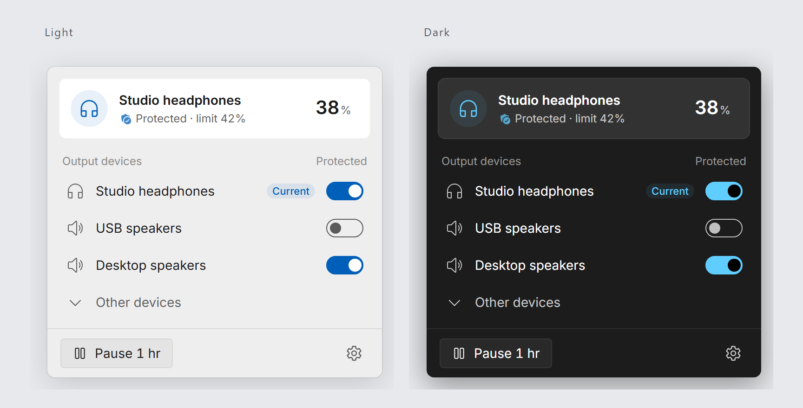

<div align="center">
  <h1>🎧 Earmuff</h1>
  <p>A quiet guard for sudden volume jumps.</p>
  <p><a href="https://github.com/Hezric/Earmuff/actions/workflows/ci.yml"></a> <a href="https://github.com/Hezric/ScoopZephyr#install"></a> <a href="https://github.com/Hezric/Earmuff/blob/main/LICENSE"></a></p>
  <p>English | <a href="README_zh-Hans.md">简体中文</a></p>
</div>

<p align="center"><br><sub>Browser preview with simulated devices. Windows uses its native material.</sub></p>


Earmuff watches your Windows output and softens sudden volume jumps. New devices are protected by default: full volume drops to 10%, and other levels above 42% are capped. Each device has its own switch.

## Install

On Windows 11 with WebView2, install from [ScoopZephyr](https://github.com/Hezric/ScoopZephyr):

```powershell
scoop bucket add zephyr https://github.com/Hezric/ScoopZephyr
scoop install zephyr/earmuff
```

Or download the Windows x64 archive from [Releases](https://github.com/Hezric/Earmuff/releases/latest), verify `SHA256SUMS`, and extract it. Launching enables protection immediately. Manage login startup separately; with Scoop, point it at the `current` executable.

## Use with an agent

```text
Install Earmuff from https://github.com/Hezric/Earmuff/releases/latest.
Verify the Windows x64 archive against SHA256SUMS, extract it, and check
earmuff.exe exists and read (Get-Item <path-to-earmuff.exe>).VersionInfo.FileVersion
without launching. Preserve settings and startup registration.
Launching enables volume protection; ask for authorization before launch.
Install the earmuff Skill separately through my existing Skill manager. If I have
none, ask first and recommend npx skills add Hezric/Earmuff -g (Vercel skills CLI,
https://github.com/vercel-labs/skills; Node.js 22.20+). Verify its path and contents.
```

## Use

Click the tray icon to open the flyout; right-click to pause, resume, or quit. Choose devices and limits in settings. An unprotected device is left untouched; restarting resumes protection. Settings default to `%APPDATA%\Earmuff\Earmuff.toml`.

Earmuff limits Windows volume percentages, not measured sound pressure.

Scoop enables portable data automatically. Outside Scoop, stop the app and create an empty `portable` file beside the executable; settings then use `data/Earmuff.toml`. See the behavior guide below before migrating existing settings.

[Usage and behavior](https://github.com/Hezric/Earmuff/blob/main/docs/features/volume-guard.md) · [Contribute and automated tests](https://github.com/Hezric/Earmuff/blob/main/CONTRIBUTING.md) · [MIT license](https://github.com/Hezric/Earmuff/blob/main/LICENSE) · [Third-party notices](https://github.com/Hezric/Earmuff/blob/main/THIRD-PARTY-NOTICES.md)

The portable archive includes license notices in `licenses/`.
