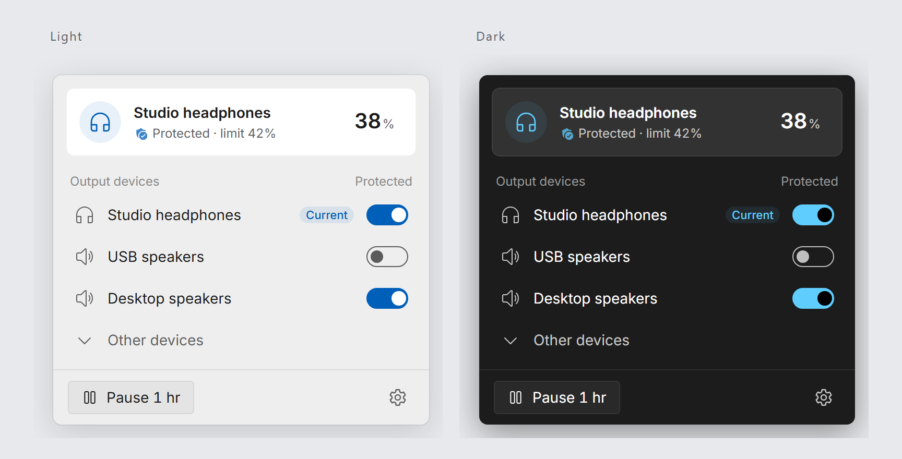

<div align="center">
  <h1>🎧 Earmuff</h1>
  <p>守住耳边的安静。</p>
  <p><a href="https://github.com/Hezric/Earmuff/actions/workflows/ci.yml"></a> <a href="https://github.com/Hezric/ScoopZephyr#install"></a> <a href="https://github.com/Hezric/Earmuff/blob/main/LICENSE"></a></p>
  <p><a href="README.md">English</a> | 简体中文</p>
</div>

<p align="center"><br><sub>使用模拟设备的浏览器预览；Windows 中使用原生材质。</sub></p>


Earmuff 守候 Windows 输出设备，防止音量突然升高。新设备默认受保护：音量跳到满格时降至 10%，其他高于 42% 的音量会被压回上限。每台设备都可单独开关保护。

## 安装

在装有 WebView2 的 Windows 11 上，通过 [ScoopZephyr](https://github.com/Hezric/ScoopZephyr) 安装：

```powershell
scoop bucket add zephyr https://github.com/Hezric/ScoopZephyr
scoop install zephyr/earmuff
```

也可从[发布页](https://github.com/Hezric/Earmuff/releases/latest)下载 Windows x64 便携包，对照 `SHA256SUMS` 校验后解压。启动即启用保护。登录启动请另行管理；使用 Scoop 时指向 `current` 目录下的程序。

## 交给智能体

```text
从 https://github.com/Hezric/Earmuff/releases/latest 安装 Earmuff。
对照 SHA256SUMS 校验 Windows x64 便携包，解压并确认 earmuff.exe 存在；不要启动，
用 (Get-Item <earmuff.exe 路径>).VersionInfo.FileVersion 读取文件版本。
保留已有设置和登录启动登记。启动会启用音量保护，启动前先取得授权。
通过我已有的 Skill 管理方式单独安装 earmuff Skill。若没有，请先询问，建议使用
npx skills add Hezric/Earmuff -g（Vercel skills CLI，https://github.com/vercel-labs/skills；
要求 Node.js 22.20 及以上）。确认安装位置和完整内容。
```

## 使用

单击托盘图标打开面板，右键可暂停、恢复或退出；打开过程中连续点击会保留打开请求，面板展开完成后再点击即可关闭。在设置中选择设备和音量限制。关闭保护的设备不会被调整；重启后恢复保护。设置默认保存在 `%APPDATA%\Earmuff\Earmuff.toml`。

Earmuff 限制的是 Windows 音量百分比，并非实测声压。

Scoop 会自动启用便携数据。手动使用时，先停止程序，在 exe 旁建立空文件 `portable`，设置便会改用旁边的 `data/Earmuff.toml`。迁移现有设置前请阅读下方行为说明。

[使用与行为](https://github.com/Hezric/Earmuff/blob/main/docs/features/volume-guard.md) · [参与贡献与自动化测试](https://github.com/Hezric/Earmuff/blob/main/CONTRIBUTING.md) · [MIT 许可](https://github.com/Hezric/Earmuff/blob/main/LICENSE) · [第三方声明](https://github.com/Hezric/Earmuff/blob/main/THIRD-PARTY-NOTICES.md)

便携包的 `licenses/` 中附有许可声明。
